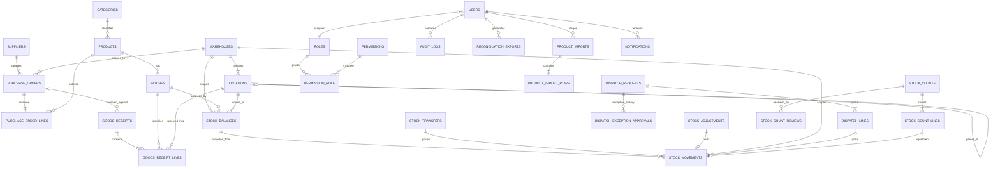

# Mukwano WIMS — Phase 1 Architecture and Data Design

**Status:** architecture proposal; no application code or migrations were
changed for this document. This target design incorporates the locked decisions
in the Phase 1 request and supersedes incompatible earlier implementation
choices where noted.

## 1. Locked decisions

- One seeded **Namanve Warehouse** is visible. There is no warehouse switcher
  and no cross-warehouse transfer UI.
- `warehouses.id` is a real foreign key on every row in the location hierarchy
  and on each stock balance. Operational documents and stock movements also
  carry a warehouse FK so the server can enforce warehouse scope.
- Bin-to-bin transfers are atomic, within one warehouse, and represented in
  the movement ledger.
- The app tracks quantities only. There are no unit costs, stock valuations,
  currencies, or financial totals.
- Offline mode may cache explicitly approved read-only views. It must not queue
  or replay writes. Every receipt confirmation, dispatch post, transfer, count
  submission/approval, import, and other stock-changing action requires a live
  server response.
- A **Dispatch Officer** may post a dispatch that satisfies normal FEFO rules.
  A **Warehouse Manager** alone may authorize an exception (for example, a
  FEFO deviation); authorization and posting are separately audited.
- Visual and navigation requirements in the WIMS UI/UX design system are
  binding: one primary blue, navy navigation, neutral panels, named/icon
  statuses, responsive mobile-first priority flows, local essential images,
  and accessible keyboard/focus/touch behavior.

## 2. Architecture overview

### Application shape

Use a Laravel 12 modular monolith with MySQL as the authoritative operational
store. Blade pages provide the server-rendered, accessible application;
small JavaScript modules progressively enhance global search, charts, QR
scanning, network status, and PWA behavior. Keep write workflows usable as
normal online forms and post them to authenticated Laravel endpoints protected
by session authentication, policies, validation, and CSRF.

Controllers coordinate HTTP concerns only. Form Requests validate input;
Policies/Gates authorize it; domain services perform transactional business
operations; Eloquent models express relationships; audit and alert services
record secondary effects. No controller, scheduled task, import, or API handler
may update a stock balance outside the inventory posting service.

### Read-only offline behavior

The service worker may cache the application shell and a narrow allowlist of
GET-only pages/reference responses. It must:

1. Never intercept, defer, queue, replay, or claim success for a mutation.
2. Show an obvious stale/offline label and the cached timestamp for every
   cached operational view.
3. Keep cached responses scoped to the signed-in user and warehouse; clear
   private cache on sign-out/account switch and expire it on a defined TTL.
4. Avoid caching audit data, credentials, CSRF/session tokens, or sensitive
   reports unless separately approved.
5. Require a live server for all stock-affecting actions and display a clear
   retry/error state when the network is unavailable.

The current implementation has an IndexedDB transaction queue and
`offline_syncs` table. Those are **not part of this target architecture** and
must be removed/retired when this design is implemented. Online idempotency
protection may remain server-side to protect against accidental double-clicks;
it is not an offline queue.

### Future Flutter boundary

There is no Flutter client or versioned API in this design baseline. If one is
approved later, expose a versioned JSON API over TLS that calls the same
policies and domain services. Do not expose browser session cookies as mobile
credentials and do not build a second inventory-posting implementation.

### UI composition

- **Desktop:** persistent deep-navy left navigation, current item highlighted,
  operational links first, administration grouped below; top bar with centered
  accessible global search, notification count, a short "System Online" label
  with green dot (or icon and "Offline"), and logged-in user/role menu;
  breadcrumbs on inner pages. The shell is login-aware: authenticated users do
  not see a Sign in link.
- **Tablet/mobile:** collapsible navigation drawer and a bottom action bar for
  Search, Scan, Receive, Count, and Dispatch. Apply role checks on the server
  as well as hiding ineligible links.
- **Dashboard:** match the supplied visual reference's hierarchy and spacing.
  The desktop page has a main column and right rail; tablet moves the rail below
  the main column; phone uses 2x2 KPI cards and single-column chart/table cards.
  The welcome banner uses a local warehouse image with overlay, the logged-in
  user's first name, today's date, and a static warehouse/location card.
  Initially show four live-query KPIs (Total Products, Total Stock Quantity,
  Active Batches, Warehouse Locations), with links to their filtered lists.
  Countable units display as whole numbers. Keep filters out of the top of the
  dashboard. A cycle-count accuracy widget with no recorded counts says
  "No counts yet", not "0.00%". Add the
  severity/recency-ordered alerts panel, category-stock donut, seven-day
  received-vs-issued line chart, expiry donut, and low-stock table when Phase 9
  supplies their data. Each chart has a filter appropriate to its dimension,
  legend, and accessible table alternative. Recent movement, receipt, and
  dispatch table cards arrive with their underlying workflows in Phases 5–7.
  The right rail has role/route-gated quick actions; report downloads arrive in
  Phase 10 and the install card in Phase 12. Show the Install button only
  while the browser reports the PWA as installable.
- **Dashboard data integrity:** never hardcode counts, chart series, table rows,
  dates, user names, alert counts, or report values. Query implemented data
  sources; until a source exists, show a meaningful empty state rather than
  fabricated or sample-like numbers. Any intentionally seeded demonstration
  data must be visibly labeled **Sample data**. Hide each action/link until
  both its route exists and the current role is authorized. An install prompt
  appears only when the browser signals that the app is installable.
- **Dashboard component delivery order:** Phase 2 builds the app shell and
  shared primitives and corrects the existing dashboard's four KPI cards,
  filter placement, empty-count wording, whole-number units, and install
  eligibility. Phase 3 builds seeded demo records, clearly labeled
  **Sample data**, and the dashboard skeleton with
  `welcome-banner`, `warehouse-info-card`, `quick-actions`, and `kpi-card`,
  wired only to real counts already available. Phases 5–7 add
  `data-table-card` instances as receipts, movements, and dispatches become
  available. Phase 9 adds `alerts-panel`, `alert-item`, the three `chart-card`
  visualizations with table alternatives, and the low-stock table. Phase 10
  adds `download-reports` and `report-download-row`. Phase 12 adds
  `install-app-card` with the manifest and service worker, without a
  transaction queue.
- **Workflow priorities:** guided receiving; scan/search bin enquiry; FEFO
  dispatch; count tasks and approval state; exportable 30/60/90-day expiry
  views; staged CSV preview/validation/confirm/error download.
- **Assets:** locally stored, resized/compressed warehouse and product imagery,
  local placeholder and empty-state illustrations, and admin-managed logo.
  No remote image is essential for operation.

## 3. Database conventions

Target database: MySQL 8+ (or a tested compatible MariaDB release), InnoDB,
`utf8mb4`. `id` is normally `BIGINT UNSIGNED` primary key; `created_at` and
`updated_at` are nullable `TIMESTAMP` columns for Laravel-managed timestamps.
Use UTC in storage and the configured local timezone for presentation.

Types below use MySQL notation. `DECIMAL(12,3)` is quantity only and is never
declared `UNSIGNED`. Every persisted non-negative quantity has an explicit
database `CHECK (column >= 0)` in addition to request/service validation;
signed variance and adjustment deltas remain signed `DECIMAL` values.
Foreign-key deletes default to `RESTRICT`;
only dependent detail rows and disposable cache/staging rows cascade.

This is the **target schema**, not a claim that every target column or table is
already present. The repository currently has many of the operational tables,
but it lacks the `warehouses` table/FKs and the relationships described below
must be migrated carefully.

## 4. Core data dictionary

### Identity and authorization

| Table | Columns, types, keys, and purpose |
|---|---|
| `users` | `id BIGINT UNSIGNED PK`; `name VARCHAR(255)`; `email VARCHAR(255) UNIQUE NOT NULL`; `email_verified_at TIMESTAMP NULL`; `password VARCHAR(255)`; `role_id SMALLINT UNSIGNED FK roles.id`; `is_active BOOLEAN NOT NULL DEFAULT TRUE`; `remember_token VARCHAR(100) NULL`; timestamps. Index `(role_id,is_active)`. Never hard-delete an account with referenced activity. |
| `roles` | `id SMALLINT UNSIGNED PK`; `key VARCHAR(40) UNIQUE NOT NULL`; `name VARCHAR(100)`; `description VARCHAR(500) NULL`; `is_system BOOLEAN NOT NULL DEFAULT TRUE`; timestamps. Seed Administrator, Warehouse Manager, Storekeeper, Procurement Officer, and Dispatch Officer; optionally seed a read-only Auditor. Do not allow ad hoc privilege creation in the first release. |
| `permissions` | `id SMALLINT UNSIGNED PK`; `key VARCHAR(80) UNIQUE NOT NULL`; `name VARCHAR(120)`; `description VARCHAR(500) NULL`; timestamps. Seed the permission vocabulary in code/migrations. |
| `permission_role` | `role_id SMALLINT UNSIGNED FK roles.id`; `permission_id SMALLINT UNSIGNED FK permissions.id`; composite PK/UNIQUE `(role_id,permission_id)`; indexes `(permission_id,role_id)`. Role permissions are seeded and displayed in the Roles and Permissions screen; grant changes are audited and restricted to a deliberate administrator workflow. |
| `password_reset_tokens` | Laravel support table: `email VARCHAR(255) PK`; `token VARCHAR(255)`; `created_at TIMESTAMP NULL`. |
| `sessions` | Laravel support table: `id VARCHAR(255) PK`; `user_id BIGINT UNSIGNED NULL FK users.id`; `ip_address VARCHAR(45) NULL`; `user_agent TEXT NULL`; `payload LONGTEXT`; `last_activity INT`. Index `(user_id)` and `(last_activity)`. |

### Warehouse, locations, and catalogue

| Table | Columns, types, keys, and purpose |
|---|---|
| `warehouses` | `id BIGINT UNSIGNED PK`; `code VARCHAR(40) UNIQUE NOT NULL` (seed `NAMANVE`); `name VARCHAR(160) NOT NULL` (seed `Namanve Warehouse`); `address TEXT NULL`; `status VARCHAR(16) NOT NULL DEFAULT 'active'`; timestamps. Index `(status,name)`. Only Namanve is exposed in the initial UI. |
| `locations` | `id BIGINT UNSIGNED PK`; `warehouse_id BIGINT UNSIGNED NOT NULL FK warehouses.id`; `parent_id BIGINT UNSIGNED NULL`; `type VARCHAR(16) NOT NULL` (`warehouse`, `zone`, `rack`, `bin`, `receiving`); `name VARCHAR(160) NOT NULL`; `code VARCHAR(80) NULL`; `status VARCHAR(16) NOT NULL DEFAULT 'active'`; timestamps. `UNIQUE (warehouse_id,id)` supports same-warehouse composite FKs; `UNIQUE (warehouse_id,code)`; composite self-FK `(warehouse_id,parent_id) REFERENCES locations(warehouse_id,id)` so a child cannot point into another warehouse; indexes `(warehouse_id,parent_id,type)`, `(warehouse_id,type,status)`. Enforce `CHECK (type NOT IN ('bin','receiving') OR code IS NOT NULL)` and repeat this rule in location create/update validation. A root `warehouse` location has null parent; enforce valid parent/type hierarchy in the location service. |
| `categories` | `id BIGINT UNSIGNED PK`; `name VARCHAR(255) UNIQUE NOT NULL`; `description TEXT NULL`; `status VARCHAR(16) NOT NULL DEFAULT 'active'`; timestamps. Index `(status,name)`. |
| `products` | `id BIGINT UNSIGNED PK`; `sku VARCHAR(100) UNIQUE NOT NULL`; `sap_material_number VARCHAR(100) NULL UNIQUE`; `name VARCHAR(255) NOT NULL`; `description TEXT NULL`; `image_path VARCHAR(255) NULL`; `category_id BIGINT UNSIGNED NOT NULL FK categories.id`; `unit VARCHAR(32) NOT NULL`; `min_level DECIMAL(12,3) NOT NULL DEFAULT 0 CHECK (min_level >= 0)`; `reorder_level DECIMAL(12,3) NOT NULL DEFAULT 0 CHECK (reorder_level >= 0)`; `max_level DECIMAL(12,3) NOT NULL DEFAULT 0 CHECK (max_level >= 0)`; `status VARCHAR(16) NOT NULL DEFAULT 'active'`; timestamps. Indexes `(category_id,status)`, `(status,name)`; SKU and ERP material are unique. Validate `min_level <= reorder_level <= max_level` when max is configured. No cost/valuation columns. |
| `suppliers` | `id BIGINT UNSIGNED PK`; `name VARCHAR(255) NOT NULL`; `code VARCHAR(100) UNIQUE NOT NULL`; `contact_person VARCHAR(255) NULL`; `phone VARCHAR(50) NULL`; `email VARCHAR(255) NULL`; `address TEXT NULL`; `notes TEXT NULL`; `status VARCHAR(16) NOT NULL DEFAULT 'active'`; timestamps. Index `(status,name)`. |
| `batches` | `id BIGINT UNSIGNED PK`; `product_id BIGINT UNSIGNED NOT NULL FK products.id`; `batch_number VARCHAR(100) NOT NULL`; `manufactured_at DATE NULL`; `expires_at DATE NULL`; timestamps. `UNIQUE (product_id,batch_number)` and `UNIQUE (id,product_id)` (the latter supports composite line FKs); indexes `(expires_at,product_id)` and `(product_id,expires_at)`. A batch is product-defined; the warehouse dimension comes from its balances/locations. |

### Procurement, receipt, and put-away

| Table | Columns, types, keys, and purpose |
|---|---|
| `purchase_orders` | `id BIGINT UNSIGNED PK`; `warehouse_id BIGINT UNSIGNED NOT NULL FK warehouses.id`; `order_number VARCHAR(64) UNIQUE NULL` (assigned on create); `supplier_id BIGINT UNSIGNED NOT NULL FK suppliers.id`; `order_date DATE NOT NULL`; `expected_date DATE NULL`; `status VARCHAR(24) NOT NULL DEFAULT 'draft'`; `notes TEXT NULL`; `created_by BIGINT UNSIGNED NULL FK users.id`; `approved_by BIGINT UNSIGNED NULL FK users.id`; `approved_at TIMESTAMP NULL`; timestamps. Indexes `(warehouse_id,status,order_date)`, `(supplier_id,status)`, `(created_by,created_at)`. |
| `purchase_order_lines` | `id BIGINT UNSIGNED PK`; `purchase_order_id BIGINT UNSIGNED NOT NULL FK purchase_orders.id ON DELETE CASCADE`; `product_id BIGINT UNSIGNED NOT NULL FK products.id`; `ordered_quantity DECIMAL(12,3) NOT NULL CHECK (ordered_quantity >= 0)`; `received_quantity DECIMAL(12,3) NOT NULL DEFAULT 0 CHECK (received_quantity >= 0)` (transactionally maintained summary); timestamps. `UNIQUE (purchase_order_id,product_id)`; index `(product_id,purchase_order_id)`. |
| `goods_receipts` | `id BIGINT UNSIGNED PK`; `warehouse_id BIGINT UNSIGNED NOT NULL FK warehouses.id`; `receipt_number VARCHAR(64) UNIQUE NULL` (assigned when confirmed); `submission_token UUID UNIQUE NOT NULL` (online double-submit/idempotency guard, not an offline queue); `purchase_order_id BIGINT UNSIGNED NULL FK purchase_orders.id`; `supplier_id BIGINT UNSIGNED NOT NULL FK suppliers.id`; `received_by BIGINT UNSIGNED NOT NULL FK users.id`; `status VARCHAR(16) NOT NULL` (`draft`, `confirmed`, `cancelled`); `notes TEXT NULL`; `received_at TIMESTAMP NOT NULL`; `confirmed_at TIMESTAMP NULL`; timestamps. Indexes `(warehouse_id,received_at)`, `(supplier_id,received_at)`, `(purchase_order_id,received_at)`, `(status,received_at)`. |
| `goods_receipt_lines` | `id BIGINT UNSIGNED PK`; `goods_receipt_id BIGINT UNSIGNED NOT NULL`; `warehouse_id BIGINT UNSIGNED NOT NULL FK warehouses.id`; `product_id BIGINT UNSIGNED NOT NULL FK products.id`; `batch_id BIGINT UNSIGNED NOT NULL FK batches.id`; `location_id BIGINT UNSIGNED NOT NULL`; `quantity DECIMAL(12,3) NOT NULL CHECK (quantity >= 0)`; timestamps. Header has `UNIQUE (id,warehouse_id)`; composite FK `(goods_receipt_id,warehouse_id) -> goods_receipts(id,warehouse_id)`; composite FK `(warehouse_id,location_id) -> locations(warehouse_id,id)`; indexes `(product_id,created_at)`, `(warehouse_id,location_id,created_at)`, `(batch_id,location_id)`. Confirmed receipt lines are immutable; corrections post reversal/adjustment movements, not edits. |
| `put_away_tasks` | `id BIGINT UNSIGNED PK`; `warehouse_id BIGINT UNSIGNED NOT NULL FK warehouses.id`; `goods_receipt_id BIGINT UNSIGNED NOT NULL FK goods_receipts.id`; `status VARCHAR(16) NOT NULL DEFAULT 'pending'`; `created_by BIGINT UNSIGNED NOT NULL FK users.id`; `assigned_to BIGINT UNSIGNED NULL FK users.id`; `completed_by BIGINT UNSIGNED NULL FK users.id`; `completed_at TIMESTAMP NULL`; timestamps. Index `(warehouse_id,status,created_at)`, `(assigned_to,status)`. |
| `put_away_task_lines` | `id BIGINT UNSIGNED PK`; `put_away_task_id BIGINT UNSIGNED NOT NULL FK put_away_tasks.id ON DELETE CASCADE`; `warehouse_id BIGINT UNSIGNED NOT NULL FK warehouses.id`; `batch_id BIGINT UNSIGNED NOT NULL FK batches.id`; `source_location_id BIGINT UNSIGNED NOT NULL`; `destination_location_id BIGINT UNSIGNED NULL`; `quantity DECIMAL(12,3) NOT NULL CHECK (quantity >= 0)`; `completed_quantity DECIMAL(12,3) NOT NULL DEFAULT 0 CHECK (completed_quantity >= 0)`; timestamps. Composite same-warehouse FKs for source and destination; composite FK `(put_away_task_id,warehouse_id)` to task `(id,warehouse_id)`; indexes `(warehouse_id,source_location_id,batch_id)`, `(warehouse_id,destination_location_id,batch_id)`. Completion posts a movement; it does not directly edit balances. |

### Inventory ledger, transfers, dispatch, adjustments, and counts

| Table | Columns, types, keys, and purpose |
|---|---|
| `stock_balances` | `id BIGINT UNSIGNED PK`; `warehouse_id BIGINT UNSIGNED NOT NULL FK warehouses.id`; `batch_id BIGINT UNSIGNED NOT NULL FK batches.id`; `location_id BIGINT UNSIGNED NOT NULL`; `quantity DECIMAL(12,3) NOT NULL DEFAULT 0 CHECK (quantity >= 0)`; timestamps. Composite FK `(warehouse_id,location_id) -> locations(warehouse_id,id)`; `UNIQUE (warehouse_id,batch_id,location_id)`; indexes `(warehouse_id,location_id,batch_id)`, `(batch_id,location_id)`. This is a materialized current-balance projection, not the audit ledger. |
| `stock_movements` | `id BIGINT UNSIGNED PK`; `warehouse_id BIGINT UNSIGNED NOT NULL FK warehouses.id`; `batch_id BIGINT UNSIGNED NOT NULL FK batches.id`; `from_location_id BIGINT UNSIGNED NULL`; `to_location_id BIGINT UNSIGNED NULL`; `goods_receipt_line_id BIGINT UNSIGNED NULL UNIQUE FK goods_receipt_lines.id`; `dispatch_line_id BIGINT UNSIGNED NULL UNIQUE FK dispatch_lines.id`; `stock_count_line_id BIGINT UNSIGNED NULL UNIQUE FK stock_count_lines.id`; `stock_transfer_id BIGINT UNSIGNED NULL FK stock_transfers.id`; `stock_adjustment_id BIGINT UNSIGNED NULL UNIQUE FK stock_adjustments.id`; `performed_by BIGINT UNSIGNED NULL FK users.id`; `approved_by BIGINT UNSIGNED NULL FK users.id`; `movement_type VARCHAR(24) NOT NULL`; `reason TEXT NULL`; `quantity DECIMAL(12,3) NOT NULL CHECK (quantity > 0)`; `reference_type VARCHAR(32) NULL`; `reference_id BIGINT UNSIGNED NULL`; `transaction_group_id UUID NOT NULL`; `idempotency_key UUID NULL UNIQUE`; `moved_at TIMESTAMP NOT NULL`; timestamps. Composite FKs `(warehouse_id,from_location_id)` and `(warehouse_id,to_location_id)` reference `locations(warehouse_id,id)`; indexes `(warehouse_id,moved_at,id)`, `(warehouse_id,batch_id,moved_at)`, `(reference_type,reference_id)`, `(transaction_group_id)`, `(warehouse_id,from_location_id,moved_at)`, `(warehouse_id,to_location_id,moved_at)`. Enforce append-only in the database with `BEFORE UPDATE` and `BEFORE DELETE` triggers that `SIGNAL SQLSTATE '45000'`; alternatively revoke those privileges from the application DB role when migration and application credentials are separated. |
| `stock_transfers` | `id BIGINT UNSIGNED PK`; `warehouse_id BIGINT UNSIGNED NOT NULL FK warehouses.id`; `reason TEXT NOT NULL`; `requested_by BIGINT UNSIGNED NOT NULL FK users.id`; `posted_by BIGINT UNSIGNED NOT NULL FK users.id`; `moved_at TIMESTAMP NOT NULL`; `source_location_id BIGINT UNSIGNED NOT NULL`; `destination_location_id BIGINT UNSIGNED NOT NULL`; `source_summary VARCHAR(255) NOT NULL`; `destination_summary VARCHAR(255) NOT NULL`; `status VARCHAR(16) NOT NULL` (`posted`); timestamps. Composite same-warehouse FKs for both locations; indexes `(warehouse_id,moved_at)`, `(requested_by,moved_at)`. A header may group movements for multiple batches between its summarized source and destination; movements reference it by `stock_transfer_id`. Posted transfers are immutable; a correction is a new reversing transfer. |
| `stock_adjustments` | `id BIGINT UNSIGNED PK`; `warehouse_id BIGINT UNSIGNED NOT NULL FK warehouses.id`; `batch_id BIGINT UNSIGNED NOT NULL FK batches.id`; `location_id BIGINT UNSIGNED NOT NULL`; `direction VARCHAR(8) NOT NULL` (`increase`, `decrease`); `quantity DECIMAL(12,3) NOT NULL CHECK (quantity > 0)`; `reason TEXT NOT NULL`; `requested_by BIGINT UNSIGNED NOT NULL FK users.id`; `approved_by BIGINT UNSIGNED NULL FK users.id`; `status VARCHAR(16) NOT NULL` (`requested`, `approved`, `rejected`, `posted`); `requested_at TIMESTAMP NOT NULL`; `approved_at TIMESTAMP NULL`; timestamps. Composite same-warehouse location FK; indexes `(warehouse_id,status,requested_at)`, `(batch_id,location_id)`, `(approved_by,approved_at)`. Manual adjustments outside cycle counts do exist but always require approval and are posted only by the inventory posting service; approval alone does not affect a balance. |
| `dispatch_requests` | `id BIGINT UNSIGNED PK`; `warehouse_id BIGINT UNSIGNED NOT NULL FK warehouses.id`; `customer_name VARCHAR(255) NULL`; `destination VARCHAR(255) NULL` (customer, department, or delivery destination); `status VARCHAR(24) NOT NULL DEFAULT 'requested'`; `requested_by BIGINT UNSIGNED NOT NULL FK users.id`; `dispatched_by BIGINT UNSIGNED NULL FK users.id`; `gdn_number VARCHAR(64) NULL UNIQUE`; `exception_status VARCHAR(16) NOT NULL DEFAULT 'none'`; `requested_at TIMESTAMP NOT NULL`; `dispatched_at TIMESTAMP NULL`; `deviation_reason TEXT NULL`; timestamps. Indexes `(warehouse_id,status,requested_at)`, `(requested_by,requested_at)`, `(customer_name,status)`. Products and quantities belong to dispatch lines, allowing multiple products per request. |
| `dispatch_lines` | `id BIGINT UNSIGNED PK`; `dispatch_request_id BIGINT UNSIGNED NOT NULL`; `warehouse_id BIGINT UNSIGNED NOT NULL FK warehouses.id`; `product_id BIGINT UNSIGNED NOT NULL FK products.id`; `batch_id BIGINT UNSIGNED NOT NULL FK batches.id`; `location_id BIGINT UNSIGNED NOT NULL`; `quantity DECIMAL(12,3) NOT NULL CHECK (quantity > 0)`; timestamps. Header has `UNIQUE (id,warehouse_id)`; composite FK `(dispatch_request_id,warehouse_id) -> dispatch_requests(id,warehouse_id)`, `(warehouse_id,location_id) -> locations(warehouse_id,id)`, and `(batch_id,product_id) -> batches(id,product_id)`; `UNIQUE (dispatch_request_id,product_id,batch_id,location_id)`; indexes `(warehouse_id,product_id,batch_id,location_id)`, `(dispatch_request_id)`. |
| `dispatch_exception_approvals` | `id BIGINT UNSIGNED PK`; `dispatch_request_id BIGINT UNSIGNED NOT NULL FK dispatch_requests.id`; `requested_by BIGINT UNSIGNED NOT NULL FK users.id`; `authorized_by BIGINT UNSIGNED NOT NULL FK users.id`; `reason TEXT NOT NULL`; `decision VARCHAR(16) NOT NULL` (`authorized`, `rejected`); `decided_at TIMESTAMP NOT NULL`; timestamps. Index `(dispatch_request_id,decided_at)`, `(authorized_by,decided_at)`. Policy requires a Warehouse Manager; approver cannot post on behalf of an unauthorized dispatch officer. |
| `stock_counts` | `id BIGINT UNSIGNED PK`; `warehouse_id BIGINT UNSIGNED NOT NULL FK warehouses.id`; `location_id BIGINT UNSIGNED NOT NULL`; `product_id BIGINT UNSIGNED NULL FK products.id`; `batch_id BIGINT UNSIGNED NULL FK batches.id`; `blind_count BOOLEAN NOT NULL DEFAULT FALSE`; `status VARCHAR(16) NOT NULL DEFAULT 'draft'`; `created_by BIGINT UNSIGNED NOT NULL FK users.id`; `submitted_by BIGINT UNSIGNED NULL FK users.id`; `reviewed_by BIGINT UNSIGNED NULL FK users.id`; `review_note TEXT NULL`; `submitted_at TIMESTAMP NULL`; `reviewed_at TIMESTAMP NULL`; timestamps. Composite same-warehouse location FK; indexes `(warehouse_id,status,created_at)`, `(location_id,status)`, `(submitted_by,submitted_at)`. |
| `stock_count_lines` | `id BIGINT UNSIGNED PK`; `stock_count_id BIGINT UNSIGNED NOT NULL`; `warehouse_id BIGINT UNSIGNED NOT NULL FK warehouses.id`; `batch_id BIGINT UNSIGNED NOT NULL FK batches.id`; `location_id BIGINT UNSIGNED NOT NULL`; `system_quantity DECIMAL(12,3) NOT NULL CHECK (system_quantity >= 0)`; `physical_quantity DECIMAL(12,3) NULL CHECK (physical_quantity IS NULL OR physical_quantity >= 0)`; `variance DECIMAL(13,3) NULL`; `discrepancy_reason TEXT NULL`; `counted_by BIGINT UNSIGNED NULL FK users.id`; `exceeds_variance_threshold BOOLEAN NOT NULL DEFAULT FALSE`; timestamps. Header has `UNIQUE (id,warehouse_id)`; composite FKs to the count header `(stock_count_id,warehouse_id)` and location `(warehouse_id,location_id)`; `UNIQUE (stock_count_id,batch_id,location_id)`; indexes `(warehouse_id,location_id,batch_id)`, `(counted_by,updated_at)`. |
| `stock_count_reviews` | `id BIGINT UNSIGNED PK`; `stock_count_id BIGINT UNSIGNED NOT NULL FK stock_counts.id ON DELETE CASCADE`; `supervisor_id BIGINT UNSIGNED NOT NULL FK users.id`; `decision VARCHAR(16) NOT NULL` (`approved`, `rejected`); `reason TEXT NULL`; `reviewed_at TIMESTAMP NOT NULL`; timestamps. Index `(stock_count_id,reviewed_at)`, `(supervisor_id,reviewed_at)`. Approval is one atomic server transaction with ledger posting. |

### Configuration, alerts, audit, imports, and notifications

| Table | Columns, types, keys, and purpose |
|---|---|
| `inventory_settings` | `id BIGINT UNSIGNED PK` (one global row for the one-warehouse installation); `company_name VARCHAR(255) NULL`; `logo_path VARCHAR(255) NULL`; `variance_threshold_percent DECIMAL(7,3) NOT NULL DEFAULT 5`; `accuracy_tolerance_percent DECIMAL(7,3) NOT NULL DEFAULT 0`; `expiry_windows JSON NOT NULL` (defaults soon/warning/notice = 30/60/90 days); `updated_by BIGINT UNSIGNED NULL FK users.id`; timestamps. Constrain to singleton key `id=1` in the service. Changes are audited. |
| `alerts` | `id BIGINT UNSIGNED PK`; `condition_key VARCHAR(255) UNIQUE NOT NULL`; `warehouse_id BIGINT UNSIGNED NOT NULL FK warehouses.id`; `type VARCHAR(32) NOT NULL`; `severity VARCHAR(16) NOT NULL`; `title VARCHAR(255) NOT NULL`; `description TEXT NOT NULL`; `action_url VARCHAR(2048) NULL` (allowlisted internal route only); `condition_active BOOLEAN NOT NULL DEFAULT TRUE`; `last_seen_at TIMESTAMP NOT NULL`; `resolved_at TIMESTAMP NULL`; `resolved_by BIGINT UNSIGNED NULL FK users.id`; timestamps. Index `(warehouse_id,resolved_at,condition_active,severity,last_seen_at)`, `(type,severity)`. UI sorts severity rank first, then recency; every badge includes icon and text. |
| `audit_logs` | `id BIGINT UNSIGNED PK`; `user_id BIGINT UNSIGNED NULL FK users.id ON DELETE RESTRICT` (preserve attribution; deactivate accounts instead of deleting); `auditable_type VARCHAR(255) NOT NULL` (use an authentication event type when no model is involved); `auditable_id BIGINT UNSIGNED NULL` (null for failed login attempts where the email has no account); `event VARCHAR(100) NOT NULL`; `reason TEXT NULL`; `old_values JSON NULL`; `new_values JSON NULL`; `metadata JSON NULL` (safe request ID/IP/user agent summary; never credentials or passwords); timestamps. Indexes `(auditable_type,auditable_id,created_at)`, `(user_id,created_at)`, `(event,created_at)`, `(created_at)`. Enforce append-only at database level using `BEFORE UPDATE` and `BEFORE DELETE` triggers that `SIGNAL SQLSTATE '45000'` (or revoke those privileges from the application DB role when migration and application credentials are separated); viewer access is read-only. |
| `product_imports` | `id UUID PK`; `user_id BIGINT UNSIGNED NOT NULL FK users.id`; `status VARCHAR(20) NOT NULL` (`mapping`, `validated`, `confirmed`, `failed`, `expired`); `source_path VARCHAR(255) NOT NULL` (private disk); `original_filename VARCHAR(255) NOT NULL`; `headers JSON NOT NULL`; `mapping JSON NULL`; `row_count INT UNSIGNED NOT NULL`; `confirmed_at TIMESTAMP NULL`; timestamps. Index `(user_id,status,created_at)`, `(status,created_at)`. Restrict access to owner/admin; expire and delete private source files by retention policy. |
| `product_import_rows` | `id BIGINT UNSIGNED PK`; `product_import_id UUID NOT NULL FK product_imports.id ON DELETE CASCADE`; `row_number INT UNSIGNED NOT NULL`; `source_values JSON NOT NULL`; `mapped_values JSON NULL`; `validation_errors JSON NULL`; `existing_product_id BIGINT UNSIGNED NULL FK products.id`; `status VARCHAR(16) NOT NULL`; timestamps. `UNIQUE (product_import_id,row_number)`; index `(product_import_id,status)`. |
| `reconciliation_exports` | `id BIGINT UNSIGNED PK`; `generated_by BIGINT UNSIGNED NOT NULL FK users.id`; `filters JSON NOT NULL`; `file_path VARCHAR(255) NOT NULL` (private disk); `row_count INT UNSIGNED NOT NULL DEFAULT 0`; `status VARCHAR(16) NOT NULL` (`pending`, `completed`, `failed`, `expired`); `generated_at TIMESTAMP NULL`; timestamps. Indexes `(generated_by,created_at)`, `(status,generated_at)`. Downloads are permission-checked and private; expire files according to retention policy. |
| `notifications` | Laravel database notifications: `id UUID PK`; `type VARCHAR(255)`; `notifiable_type VARCHAR(255)`; `notifiable_id BIGINT UNSIGNED`; `data JSON`; `read_at TIMESTAMP NULL`; `created_at TIMESTAMP NULL`; index `(notifiable_type,notifiable_id,read_at,created_at)`. Notification count is user-scoped. |
| `idempotency_keys` | Optional online retry protection only: `id BIGINT UNSIGNED PK`; `user_id BIGINT UNSIGNED NOT NULL FK users.id`; `operation VARCHAR(64) NOT NULL`; `key UUID NOT NULL`; `payload_hash CHAR(64) NOT NULL`; `result_type VARCHAR(64) NULL`; `result_id BIGINT UNSIGNED NULL`; `completed_at TIMESTAMP NULL`; timestamps. `UNIQUE (user_id,operation,key)`; index `(completed_at)`. A matching retry returns its original result; payload reuse conflicts. This table is not an offline queue. |

### Laravel infrastructure

Retain Laravel `cache` (`key VARCHAR(255) PK`, `value MEDIUMTEXT`,
`expiration BIGINT`, index expiration), `cache_locks` (`key VARCHAR(255) PK`,
`owner VARCHAR(255)`, `expiration BIGINT`, index expiration), `jobs`, `job_batches`,
and `failed_jobs` as configured by the chosen queue/cache drivers. They contain
framework state, not inventory truth. Existing job/queue indexes and failed
job UUID uniqueness must be retained.

## 5. ER diagram



`stock_balances` is not a direct parent of movement rows in a literal FK sense:
the diagram's relationship denotes the aggregation/projection key
`(warehouse_id,batch_id,location_id)`. A movement may have a null source or
destination for receipt, dispatch, or adjustment.

## 6. Stock consistency and concurrency

`stock_movements` is the append-only source of truth. `stock_balances` is the
transactionally maintained projection used for fast availability reads.
For every `(warehouse,batch,location)`:

```text
balance = SUM(quantity where to_location_id = location)
        - SUM(quantity where from_location_id = location)
```

The seed/opening baseline is represented by an explicit opening movement, not
an unexplained balance. A null source represents inbound stock from outside
the warehouse; a null destination represents outbound stock.

Every stock command uses one inventory posting service and one DB transaction:

1. Validate actor, warehouse scope, document state, location type, batch and
   requested quantity.
2. Lock affected balance rows in deterministic `(warehouse,batch,location)`
   order with `SELECT ... FOR UPDATE`; create missing zero rows safely using
   the unique balance key.
3. Check sufficient stock for every outbound leg. Reject a negative result;
   never resolve a stale count by overwriting the current balance.
4. Apply balance deltas and append immutable movement rows (positive
   three-decimal quantities) in the same transaction. Transfers write one
   movement with both `from` and `to` locations; its outbound and inbound legs
   cancel for the warehouse total.
5. Update the source document, idempotency result, and audit event in the same
   transaction. A failure rolls back all effects.

Use unique receipt-line, count-line, and command idempotency keys to prevent
double posting. A background reconciliation command periodically recomputes
the ledger projection and reports mismatches; it must not silently rewrite
balances. A separately authorized repair posts corrective movements and
records an audit entry. Direct balance editing is prohibited.

### Workflow-specific invariants

- **Receipt:** review and server validation precede confirmation. Confirmation
  creates receipt, lines, inbound movements, and balance deltas atomically.
  Put-away moves quantity from the receiving location to the destination bin
  and leaves total warehouse quantity unchanged.
- **Dispatch:** FEFO candidate ranking uses current eligible balances and
  expiry; dated batches sort by earliest expiry first, with batches lacking
  expiry dates last. A compliant Dispatch Officer post atomically decreases
  balances and writes dispatch movements/lines. Any exception is first recorded and
  authorized by a Warehouse Manager; the authorization alone does not debit
  stock.
- **Count:** submission records observed quantities and a variance against a
  saved system snapshot but changes no stock. Manager approval re-locks each
  balance and verifies it still equals the snapshot before posting adjustment
  movements. A changed snapshot requires a recount.
- **Transfer:** source and destination must belong to the same warehouse;
  lock both balances in sorted order, enforce available source quantity, and
  post equal-and-opposite legs atomically.

## 7. Role-permission matrix

The five required seeded roles are Administrator, Warehouse Manager,
Storekeeper, Procurement Officer, and Dispatch Officer. A read-only Auditor is
optional. Permission names are stable keys enforced by policies/services;
navigation visibility is not authorization. The admin screen displays this
matrix. Role/permission catalog changes are audited and are not exposed as
arbitrary custom-policy editing in the first release.

| Capability | Administrator | Warehouse Manager | Storekeeper | Procurement Officer | Dispatch Officer | Auditor (optional) |
|---|---:|---:|---:|---:|---:|---:|
| View dashboard, catalogue, locations, and current stock | Yes | Yes | Yes | Yes | Dispatch-relevant | Read-only |
| Create/update products and categories | Yes | Yes | No | No | No | No |
| Manage suppliers | Yes | Yes | No | Yes | No | No |
| Manage locations and QR labels | Yes | Yes | Yes | No | No | No |
| Manage users, assign roles, activate/deactivate accounts | Yes | No | No | No | No | No |
| View roles/permission matrix | Yes | Yes | No | No | No | No |
| Edit system identity/logo/expiry and inventory settings | Yes | No* | No | No | No | No |
| View/filter audit log (read-only) | Yes | No | No | No | No | Yes |
| Create/approve purchase orders | Yes | Yes | No | Yes | No | No |
| View reorder alerts | Yes | Yes | Relevant alerts | Yes | Relevant alerts | Read-only |
| ERP CSV import/export | Yes | Reconciliation export | No | Product master import and reconciliation export | No | No |
| Receive goods and confirm GRNs | Yes | Yes | Yes | **No** | No | No |
| Complete put-away and bin-to-bin transfers | Yes | Yes | Yes | No | No | No |
| Create dispatch request | Yes | Yes | No | No | Yes | No |
| Post FEFO-compliant dispatch | Emergency only** | No | No | No | Yes | No |
| Authorize FEFO/deviation exception | Emergency only** | Yes | No | No | No | No |
| Create and submit cycle counts | Yes | Yes | Yes | No | No | No |
| Approve/reject count and post adjustment | Yes | Yes | No | No | No | No |
| Request manual stock adjustment | Yes | Yes | Yes | No | No | No |
| Approve manual stock adjustment | Emergency only** | Yes | No | No | No | No |
| View/export operational reports | Yes | Yes | Assigned operational subset | Procurement/reorder subset | Dispatch subset | Read-only subset |
| Manage/read inventory alerts | Yes | Yes | Relevant alerts | Reorder alerts | Relevant alerts | Read-only |
| Browse explicitly cached offline views | Same authorized read scope; cache remains read-only | Same | Same | Same | Same | Same |

\* Thresholds may be delegated to the Warehouse Manager if operational policy
requires it; company identity/logo and user security remain Administrator-only.
\** Administrator access is a break-glass path requiring a reason and explicit
audit event; it is not the normal approval path. A Warehouse Manager who
authorizes a specific dispatch exception cannot post that dispatch; a Dispatch
Officer posts it. Procurement Officers may manage suppliers and purchase
orders and see reorder alerts, but cannot receive goods or post any stock
movement. Storekeeper is the required role name; do not substitute Warehouse
Operator.

## 8. Proposed folder structure

Keep the established Laravel structure; add small domain groupings as the
implementation grows. Do not create a parallel API/inventory stack.

```text
app/
  Actions/
    Inventory/
      PostReceipt.php
      PostDispatch.php
      TransferStock.php
      ApproveStockCount.php
  Enums/
    DispatchStatus.php
    LocationType.php
    MovementType.php
    StockCountStatus.php
  Http/
    Controllers/
      Admin/
      Api/V1/                 # future, only when Flutter API is approved
      Auth/
      ...
    Middleware/
    Requests/
    Resources/                # future API resource serializers
  Models/
  Policies/
  Services/
    Inventory/
      BalanceProjector.php
      FefoAllocator.php
      InventoryPostingService.php
      StockReconciliationService.php
    AuditService.php
    ...
  Support/
database/
  factories/
  migrations/
  seeders/
resources/
  css/
    app.css                   # design tokens and responsive primitives
    components/
  js/
    app.js
    modules/
      global-search.js
      charts.js
      pwa-readonly-cache.js
  views/
    auth/
    dashboard/
    catalog/
    locations/
    purchase-orders/
    goods-receipts/
    put-away/
    inventory/
    dispatch/
    stock-counts/
    reports/
    erp-exchange/
    alerts/
    administration/
    components/
routes/
  web.php
  api.php                    # absent until a versioned API is approved
tests/
  Feature/
    Authentication/
    Administration/
    Inventory/
    Procurement/
    Dispatch/
    StockCounts/
    OfflineReadOnly/
  Unit/
public/
  images/                     # local optimized banner and empty states
  icons/
  service-worker.js
```

Names above are a target organization; follow existing folders where moving
files would create unnecessary churn.

## 9. Ordered implementation plan

1. **Phase 1 — Architecture (this deliverable):** agree the invariants,
   architecture, target schema, ER diagram, permissions, and migration/test
   gates before application changes.
2. **Phase 2 — Shell, authentication, and RBAC:** migrate/restyle the existing
   app (do not rebuild it). Replace the green top-navigation layout with the
   agreed navy sidebar and shared primitives; add role-aware ordered
   navigation, centered global search, notification count, short System
   Online/offline status, logged-in user/role menu, breadcrumbs, responsive
   drawer and mobile action bar. Ensure authenticated users do not see a Sign
   in link. Require authentication on the dashboard and every non-login
   application route; produce a route-by-route table of paths, authentication
   guards, and required role/policy, including routes currently outside an
   auth group. Implement account activation, the five required roles (and
   optional Auditor), server-side permission policies and safe initial-admin
   provisioning. Establish the Namanve warehouse identity and safe legacy
   mapping needed by later warehouse-scoped work. The dashboard fixes in scope
   are the four KPI cards (Total Products, Total Stock Quantity, Active
   Batches, Warehouse Locations), moving filters out of the page top, showing
   "No counts yet" instead of 0.00% with no counts, whole-number display for
   countable units, and showing Install only when the browser reports the app
   is installable. Do not build dashboard-specific charts or table cards here.
3. **Phase 3 — Categories, products, suppliers:** catalogue CRUD, validation,
   local product image handling, search/list patterns, and the dashboard
   skeleton (`welcome-banner`, `warehouse-info-card`, `quick-actions`,
   `kpi-card`). Seed realistic, deterministic demonstration records for
   dashboard review and visibly label the demo data **Sample data**. KPI
   values and any populated widgets still derive from persisted database
   records; unavailable sources render real empty states, never hardcoded
   figures. Actions show only when their route exists and the role is
   permitted.
4. **Phase 4 — Locations and QR:** warehouse/location hierarchy and
   same-warehouse constraints, location search/bin enquiry, QR generation and
   scanning/printing. No warehouse switcher.
5. **Phase 5 — Purchase orders, GRN, and batches:** procurement state machine,
   receipt and batch records, guided receiving/confirmation, GRN, and put-away
   workflow. Add dashboard receipt `data-table-card` only when real receipt
   records exist.
6. **Phase 6 — Stock ledger and transfers:** append-only movements, balance
   projection/posting service, same-warehouse transfers, deterministic
   locking, non-negative checks, online idempotency, reconciliation command,
   manual stock adjustment request, Warehouse Manager approval, and posting
   through the inventory posting service. Add reconciliation tests for
   adjustments, authorization, duplicate posting and rollback, alongside
   concurrency tests. Add recent movement `data-table-card` from persisted
   movement data.
7. **Phase 7 — FEFO dispatch:** expiry-ranked allocation, dispatch request and
   posting, Warehouse Manager exception authorization with separation of
   duties, GDN, and dispatch `data-table-card` from persisted dispatch data.
8. **Phase 8 — Cycle counts:** task list, optional blind count, variance
   reasons/summary, approval and rejection, snapshot locking/revalidation, and
   adjustment movements; test stale snapshots and duplicate approval.
9. **Phase 9 — Alerts and dashboard:** severity/recency alert lifecycle,
   near-expiry and low-stock queries, dashboard data aggregation, alert panel,
   low-stock table, category-stock donut, seven-day received-vs-issued line,
   expiry-status donut, legends, filters, and accessible table alternatives.
   All widgets use live data or show a real empty state; no hardcoded figures.
10. **Phase 10 — Reports and ERP CSV:** permission-aware PDF/CSV exports,
    staged CSV preview, mapping, validation, confirmation and downloadable
    row errors; dashboard report-download list and controls.
11. **Phase 11 — Administration:** user/role management, system settings/logo,
    read-only audit viewer and event coverage, backup/restore guidance and
    command; enforce authorization independently of navigation visibility.
12. **Phase 12 — PWA:** manifest, local icons, install prompt/card, and
    service-worker shell plus approved read-only GET cache. Retire the existing
    transaction queue, `offline_syncs` table and sync endpoints; no offline
    stock-changing actions. Test cache privacy/freshness and that mutations
    never queue or replay.
13. **Phase 13 — Hardening and release:** security, accessibility,
    responsive and query/index review; MySQL migration/restore rehearsal; full
    test suite, representative query plans, production configuration, user
    manual and future API contract review.

## 10. Existing code gap analysis

This is an incremental migration/restyling of the existing Laravel application,
not a greenfield rebuild.

### Existing foundations to retain and extend

- Laravel 12, Blade, MySQL migrations, authentication, active-user middleware,
  shared controllers/services, and existing feature/unit tests.
- Existing catalogue tables for categories, products, and suppliers, plus
  their current CRUD and local product-image handling.
- Existing location hierarchy and QR workflows, purchase orders, goods
  receipts, batches, stock balances, stock movements, dispatch requests/lines,
  cycle counts, inventory settings, alerts, reports, ERP exchange, audit log,
  and administration screens. Reuse and migrate these records and workflows.
- Existing transactional inventory operations and balance reconciliation
  foundations should be brought under the single posting-service invariant;
  do not replace them with a parallel implementation.

### Existing behavior/schema to change

- Add the `warehouses` master and backfill `warehouse_id` onto locations,
  balances, movements, and all relevant operational documents/lines. Add
  same-warehouse composite constraints and indexes after data reconciliation.
- Migrate existing role values and config-based authorization to the required
  Administrator, Warehouse Manager, Storekeeper, Procurement Officer, and
  Dispatch Officer roles; optionally add read-only Auditor. Enforce all
  permissions on the server and verify authentication coverage for every
  non-login route.
- Replace `DECIMAL UNSIGNED` quantity definitions with signed `DECIMAL` plus
  explicit non-negative CHECK constraints. Enforce database-level
  append-only behavior for both `stock_movements` and `audit_logs`; make
  `audit_logs.user_id` RESTRICT on delete.
- Require a location code for `bin` and `receiving` types using both the
  location service and database CHECK constraint. Ensure FEFO puts batches
  without expiry dates after dated batches.
- Extend audit records for nullable subjects, unknown-email failed logins,
  reason capture, and safe metadata. Add the reconciliation export records.
- Expand dispatch from one product/quantity on its header to multi-product
  dispatch lines; add customer and destination/department fields.
- Add stock-transfer headers linked to their movement rows, and approved
  manual stock-adjustment requests linked to posting-service movements.
- Replace the current green top-navigation shell with the responsive navy
  shell, role-aware navigation and shared primitives. Add the phased
  dashboard behavior without hardcoded metrics.

### Existing behavior to remove or retire

- Remove/retire the IndexedDB transaction queue in `resources/js/app.js`,
  the `offline_syncs` table, `OfflineSyncController` sync endpoints and their
  service/retry behavior. Offline becomes read-only cached GET views only;
  no stock-changing operation is queued or replayed. Keep online idempotency
  protection where it prevents duplicate submissions.

### Data migration safeguards

Back up the database and record baseline balances before schema changes. Map
existing root locations to the seeded Namanve warehouse, backfill warehouse
scope in dependency order, and reconcile `bin_inventory`, `stock_balances`,
and `stock_movements` before retiring any legacy source. Migrations must be
forward-safe for existing data; do not use destructive reset/reseed steps on
the operational database.

#### Phase 2 pre-migration safety gate

Before any Phase 2 migration, stop stock-changing activity, run this Windows
PowerShell backup (it prompts for the MySQL password), and verify that the
resulting SQL file exists and is non-empty. The shown XAMPP path and database
match the current workstation; adjust only the executable path if XAMPP was
installed elsewhere.

```powershell
New-Item -ItemType Directory -Force -Path .\backups | Out-Null
& $env:ComSpec /c '"C:\xampp\mysql\bin\mysqldump.exe" --host=127.0.0.1 --port=3306 --user=root --password --single-transaction --routines --triggers mukwano_wims > "E:\mukwano WIMS\backups\mukwano_wims-pre-phase2.sql"'
if ($LASTEXITCODE -ne 0) { throw "Database backup failed; do not migrate." }
Get-Item .\backups\mukwano_wims-pre-phase2.sql | Select-Object FullName, Length
```

Then open a MySQL client against `mukwano_wims` and run the following baseline
reconciliation query. It must return **zero rows** before any migration; if it
returns a discrepancy or fails because the current schema differs, stop and
reconcile/inspect first. Preserve the output with the backup. This compares
the current pre-warehouse `(batch_id, location_id)` grain.

```sql
WITH movement_legs AS (
    SELECT batch_id, to_location_id AS location_id, quantity AS delta
    FROM stock_movements
    WHERE to_location_id IS NOT NULL

    UNION ALL

    SELECT batch_id, from_location_id AS location_id, -quantity AS delta
    FROM stock_movements
    WHERE from_location_id IS NOT NULL
),
ledger AS (
    SELECT batch_id, location_id, SUM(delta) AS ledger_quantity
    FROM movement_legs
    GROUP BY batch_id, location_id
),
balances AS (
    SELECT batch_id, location_id, SUM(quantity) AS balance_quantity
    FROM stock_balances
    GROUP BY batch_id, location_id
),
balance_keys AS (
    SELECT batch_id, location_id FROM balances
    UNION
    SELECT batch_id, location_id FROM ledger
)
SELECT keys.batch_id,
       keys.location_id,
       COALESCE(balances.balance_quantity, 0) AS balance_quantity,
       COALESCE(ledger.ledger_quantity, 0) AS ledger_quantity,
       COALESCE(balances.balance_quantity, 0)
         - COALESCE(ledger.ledger_quantity, 0) AS difference
FROM balance_keys AS keys
LEFT JOIN balances
    ON balances.batch_id = keys.batch_id
   AND balances.location_id = keys.location_id
LEFT JOIN ledger
    ON ledger.batch_id = keys.batch_id
   AND ledger.location_id = keys.location_id
WHERE COALESCE(balances.balance_quantity, 0)
   <> COALESCE(ledger.ledger_quantity, 0)
ORDER BY keys.batch_id, keys.location_id;
```

Run `php artisan migrate --pretend` for review only after the backup and
zero-row reconciliation. Apply forward migrations with `php artisan migrate
--force` only after reviewing the SQL and confirming the backup is restorable.
Never use `migrate:fresh`, `db:wipe`, or generic production reseeding on the
operational database. Role/permission setup and initial-admin provisioning
must use narrowly scoped, idempotent seeders; never run demo-data seeders
against operational data.

## 11. Migration and acceptance gates

- A warehouse/location invariant test proves no balance, movement, receipt,
  dispatch line, count line, or transfer can cross warehouses.
- Database tests prove stock movements reject UPDATE and DELETE attempts, all
  non-negative quantities reject negative values, and approved manual
  adjustments affect balances only through immutable posting-service
  movements.
- For a seeded stock set, recomputed movement projection exactly equals every
  balance at three-decimal precision; reconciliation is zero before and after
  receipt, put-away, dispatch, transfer, adjustment, and rollback tests.
- Two concurrent outbound posts cannot make a balance negative or debit it
  twice; a failed multi-line transaction leaves both the ledger and balance
  unchanged.
- FEFO exception requires a Warehouse Manager authorization before posting;
  the approval and dispatch are separately attributable in the audit trail.
- Offline UI reads are clearly stale-marked and may not mutate or queue any
  operational transaction.
- Dashboard KPI/charts query real database records, contain accessible table
  alternatives, show empty states when records do not exist, label seeded demo
  figures as Sample data, and expose severity as icon plus text.
- Unauthenticated requests are denied on every non-login route; authenticated
  navigation omits Sign in, and role/permission checks apply even when a link
  is hidden.
- Phone/tablet/desktop, keyboard-only navigation, focus visibility,
  screen-reader labels, empty/error states, and 44px interactive targets are
  checked on prioritized workflows before release.
